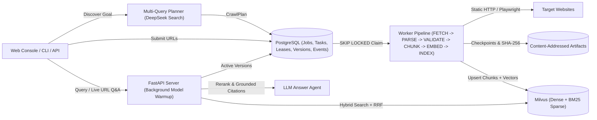

# HarvestRAG

<p align="center">
  <strong>Production-Grade Autonomous Web-to-RAG Knowledge Base Engine</strong><br>
  Resilient multi-stage web ingestion, immutable versioned hybrid search (Dense + BM25 + RRF + Reranker), and grounded citation Q&A — built with PostgreSQL, Milvus, Playwright, and FastAPI.
</p>

<p align="center">
  
  
  
  
  
</p>

---

**HarvestRAG** 是一个面向工程落地的**自主网页采集与混合检索问答（RAG）系统**。它打通了「**AI 多路搜索发现 → 断点可恢复的多 Worker 采集管道 → 结构化清洗与质量门禁 → 不可变版本向量入库 → Dense + BM25 混合检索与精排问答**」全链路，并提供单页 Web 控制台、完整 CLI 工具链与 Docker Compose 监控部署方案。

---

## 核心工程亮点（Engineering Highlights）

- **高可靠任务队列与断点恢复（PostgreSQL Lease + Checkpoints）**
  - 基于 PostgreSQL `FOR UPDATE SKIP LOCKED` 实现多 Worker 并发领取、租约心跳（Heartbeat）与超时自动接管。
  - 采集管道划分为 6 个原子阶段：`FETCH → PARSE → VALIDATE → CHUNK → EMBED → INDEX`，每阶段写入内容寻址产物（fsync + SHA-256 校验）并记录 Checkpoint，任意节点崩溃后可从断点无损恢复。
- **不可变版本发布与防覆盖保护（Version Fencing）**
  - 向量库以不可变 `version` 作为隔离单元，仅当 Milvus 写入完全可见（Strong Consistency 校验）后才原子切换 PostgreSQL `current_version`。
  - 严格防止慢速旧任务覆盖新任务已发布版本；检索结果在返回前二次校验活跃版本，杜绝读到已退役（`RETIRED`）脏数据。
- **混合检索 + Cross-Encoder 精排 + 证据强约束问答**
  - 检索层结合 **BGE-M3 Dense 向量** 与 **Milvus 原生 BM25 稀疏检索**，经 **RRF（Reciprocal Rank Fusion）** 融合后由 **`bge-reranker-v2-m3`** 精排并做阈值过滤（默认 `rerank_min_score=0.20`）。
  - 服务端启动时后台守护线程自动预热模型（`Retriever.warmup()`），消除冷启动首问延迟；`candidates=15` 在 CPU 模式下即可将平均检索耗时控制在 ~2 秒。
  - 回答生成强制校验所有引用 URL 必须出自检索到的真实证据片段，否则拒绝输出。
- **自主多查询发现规划器（Autonomous Multi-Query Planner）**
  - 面对复杂采集目标，先由 LLM 拆解为 1–3 条互补检索词并行调用 DeepSeek Search，按规范化 URL 合并去重、统计跨查询命中次数（`hits`）与排名后，由模型在真实搜索候选集合内严选种子 URL。
- **通用正文识别与抗噪清洗（Zero Per-Site Hardcoding）**
  - 结合 HTTP 条件请求（ETag / Last-Modified / 304 增量复用）与 Worker 级共享 Playwright 浏览器回退，内置 Cookie 横幅、弹窗、Load More 分页、CAPTCHA / Auth 检测与 429/5xx 退避策略。
  - 集成 `Trafilatura` + 通用语义容器打分与重复条目识别（`pipeline/main_extract.py`），自动过滤 CSS/JS 残留与导航噪声，低质量或疑似重复页面自动进入 `REVIEW_REQUIRED` 人工审核队列。

---

## 系统架构（Architecture）



---

## 快速开始（Quick Start）

### 方式一：本地开发运行

#### 1. 环境准备
- Python **3.10+**
- PostgreSQL **15+** 与 Milvus **2.6+**（可通过下方 `compose.v2.yaml` 启动基础设施）

```bash
git clone https://github.com/hajihao666/HarvestRAG.git
cd HarvestRAG

python -m venv .venv
# Windows: .venv\Scripts\activate
# macOS / Linux: source .venv/bin/activate

pip install -r requirements.txt
pip install -r requirements-v2.txt
playwright install chromium
```

#### 2. 配置环境变量
```bash
copy .env.example .env          # Windows
copy .env.v2.example .env.v2
```
在 `.env` 中填入你的模型密钥（如 `DEEPSEEK_API_KEY`），在 `.env.v2` 中配置 `V2_DATABASE_URL`、`V2_MILVUS_URI` 及 `V2_API_KEY`。

#### 3. 初始化数据库并启动服务
```bash
python -m v2 init
python -m v2 serve --host 127.0.0.1 --port 8000
# 另开终端启动采集 Worker
python -m v2 worker
```
浏览器访问 **`http://127.0.0.1:8000/`** 即可打开 HarvestRAG 控制台。

### 方式二：Docker Compose 部署（含可选监控）
```bash
docker compose -f compose.v2.yaml up -d --build
# 如需 Prometheus + Grafana 监控面板：
docker compose -f compose.v2.yaml -f compose.monitoring.yaml up -d
```

---

## 控制台与核心接口（Console & API）

Web 控制台（`v2/index.html`）提供 **6 个核心视图**：
- **采集**：手动批量提交 URL（支持 `seeds` / `links` / `sitemap` / `links+sitemap` 与 `structured` / `llm` 提取模式）及 AI 自主发现计划生成。
- **问答**：知识库混合检索问答（可调 `k` / `candidates`、结构化证据卡片、可点击引用）与单 URL 实时抓取问答（`/live`）。
- **知识库**：实时浏览已发布文档列表、搜索过滤及逐条查看 Milvus Chunk 原文。
- **任务**：最近任务快捷切换、实时进度轮询、停止任务（`/jobs/{id}/cancel`）及失败/待审核任务行内一键重试。
- **日志**：全链路流水线审计表（`fetch_attempt` / `strip_attempt` / `validation` / `chunk_complete` / `published` / `answer`），支持 URL 片段与事件类型过滤。
- **数据**：语料实时指标统计与按 URL 级联删除（任务、版本、向量、事件）。

### 常用 REST API
| 方法与路径 | 说明 |
|---|---|
| `GET /health` · `GET /ready` | 服务存活与 PostgreSQL / Milvus 就绪检查 |
| `POST /plans/discover` | 自主多查询拆解并生成 `CrawlPlan` |
| `POST /jobs` · `POST /jobs/{id}/cancel` | 提交采集任务 / 取消任务 |
| `GET /documents` · `GET /documents/{id}/chunks` | 分页检索已发布文档与 Milvus Chunk 明细 |
| `DELETE /documents?url=...` | 级联清理指定 URL 的任务、版本与向量 |
| `POST /query` · `POST /live` | 知识库混合检索问答 / 按 URL 实时问答 |
| `GET /events` · `GET /metrics` | 流水线审计事件与 Prometheus 指标 |

### 常用 CLI 命令
```bash
python -m v2 submit https://docs.python.org/3/ --discover links --max-pages 30
python -m v2 plan "构建 Python asyncio 官方文档知识库" --output plan.json
python -m v2 run urls.txt --workers 2 --extract structured
python -m v2 query "asyncio 事件循环是如何工作的？" --answer
python -m v2 live https://example.com/article --question "核心结论是什么？" --answer
python -m v2 cleanup
```

---

## 项目结构（Repository Structure）

```text
HarvestRAG/
├── v2/                     # V2 核心引擎：API、Worker、PostgreSQL 持久化、Milvus 存储、检索、Planner、控制台
│   ├── api.py              # FastAPI 服务与后台模型预热
│   ├── worker.py           # 6 阶段可恢复执行器与版本发布防护
│   ├── db.py & schema.sql  # PostgreSQL 任务队列、租约、Checkpoint、版本与事件审计
│   ├── store.py            # Milvus Dense + BM25 混合向量库封装
│   ├── retrieval.py        # 混合检索、Cross-Encoder 精排与引用校验
│   ├── planner.py          # 多查询拆解、并发搜索、候选合并去重
│   ├── fetch.py & obstacles.py # 自适应抓取与 V1 障碍处理策略
│   └── index.html          # 单页 Web 控制台
├── pipeline/               # 通用正文提取（Trafilatura + 容器打分 + 条目识别）、语义分块与本地 Embedding
├── agents/                 # LLM 结构化提取、修复与带引用问答 Agent（Prompt 模板与 Schema 校验）
├── config/                 # 抓取、障碍策略、Embedding 与 Agent 配置及 JSON Schema
├── deploy/                 # Prometheus 与 Grafana 数据源配置
├── tools/                  # 检索评估（eval_retrieval.py）与正文提取回归脚本（regression_extract.py）
├── tests/                  # 单元测试、Playwright UI 冒烟测试、评估集与外部服务集成测试
├── compose.v2.yaml         # V2 容器编排（PostgreSQL + Milvus + API + Worker）
└── SPEC_V2.md              # V2 架构规格与核心不变量说明
```

---

## 测试与检索评估（Testing & Evaluation）

```bash
# 运行核心单元测试与 Playwright 控制台测试
pytest -q

# 运行带真实 PostgreSQL / Milvus 的集成测试（需配置 V2_TEST_DATABASE_URL / V2_TEST_MILVUS_URI）
pytest tests/test_v2_services.py -q

# 运行检索召回率与阈值离线评估
python tools/eval_retrieval.py --candidates 15
```

---

## 延伸文档
- [V2 架构规格说明](SPEC_V2.md)
- [快速启动与部署指南](docs/V2_QUICKSTART.md)
- [开发交接与测试记录](docs/V2_HANDOFF.md) · [V2 验证报告](docs/V2_TEST_RESULTS.md)
